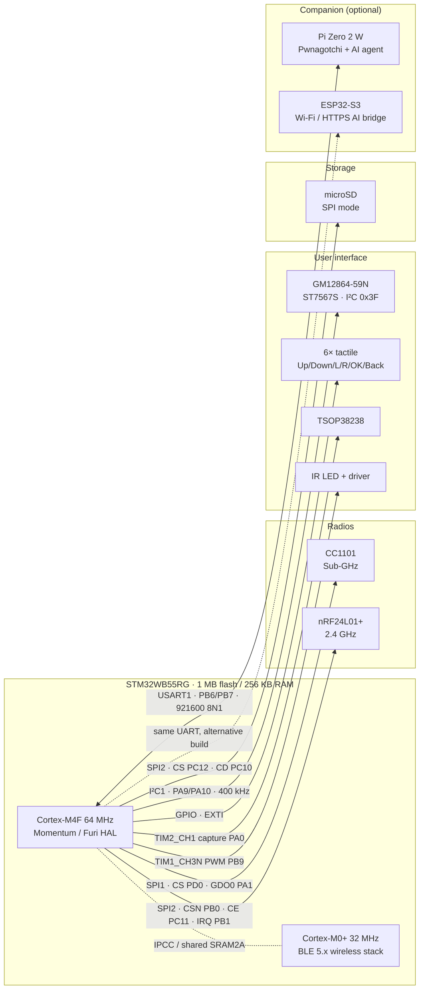
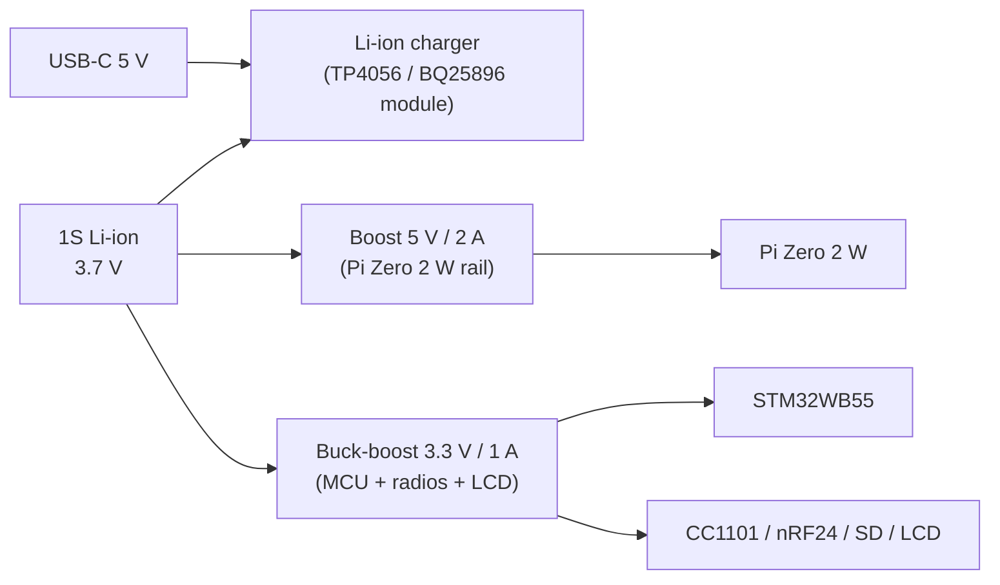

# momentum-wb55-custom-clone

A buildable, documented **DIY Flipper Zero-class multi-tool** built around an
**STM32WB55** and the **Momentum** firmware, with three deliberate deviations
from stock hardware:

| Stock Flipper Zero | This project |
| --- | --- |
| ST7565/ST7567 128×64 **SPI** LCD | **Estardyn GM12864-59N** 128×64 **I²C** COG LCD (ST7567S controller) |
| No 2.4 GHz radio | **nRF24L01+** on the SPI2 pins freed by the I²C display |
| No Wi-Fi / AI | Optional **companion co-processor** (Pi Zero 2 W or ESP32-S3) on USART1 for Pwnagotchi + AI agent |

Everything else is intentionally kept **pin-compatible with Flipper Zero's
`targets/f7` board layer**, so Momentum's HAL, GUI, Sub-GHz, IR and storage
stacks can be reused instead of rewritten.

> **Status:** research complete, repository scaffolded, code **not yet built or
> run on hardware**. Every "verified" claim in the docs cites its source; every
> "unverified / TODO" item is marked as such.
>
> **Not a piracy project.** This is an independent hobbyist board. It does not
> redistribute Flipper firmware binaries, and it does not submit code upstream
> to Momentum (whose repository policy prohibits AI-generated contributions).

---

## 1. What this is (and is not)

**Is:** a carrier-board design + firmware target + companion protocol that turns
an STM32WB55 dev board and ~15 € of breakout modules into a Momentum-running
multi-tool with an I²C display, a second 2.4 GHz radio, and an optional
Wi-Fi/AI brain.

**Is not:** a 1:1 Flipper Zero clone. The stock device also contains an
ST25R3916 NFC front-end, a 125 kHz RFID analog front-end, an iButton reader, a
BQ25896 charger, a BQ27220 fuel gauge, an LP5562 RGB LED driver, a vibration
motor, a speaker, and a 2100 mAh battery with a full power path. None of those
are on the mandatory BOM here. Missing modules are either stubbed or excluded
from the build (see [`docs/RESEARCH_FINDINGS.md`](docs/RESEARCH_FINDINGS.md)
§4 and [`firmware/target_f55/README.md`](firmware/target_f55/README.md)).

## 2. Hardware inventory (fixed by the brief)

| Block | Part | Interface | Notes |
| --- | --- | --- | --- |
| MCU | STM32WB55RG (VFQFPN68) on Nucleo-WB55RG, or WB55CG (UFQFPN48) on WeAct | — | Dual-core: M4F app + M0+ BLE/802.15.4 stack. 1 MB flash, 256 KB RAM. |
| Display | Estardyn/Tenstar **GM12864-59N**, 128×64 COG, 4-pin | **I²C**, addr `0x3F` | Controller: **ST7567S**. Backlight hard-wired on the module. |
| Sub-GHz | CC1101 module (433/868 MHz) | SPI + GDO0 | 3.3 V only. |
| 2.4 GHz | nRF24L01+ (PA/LNA optional) | SPI + CE/CSN/IRQ | 3.3 V, 10–100 µF bulk decoupling mandatory. |
| IR RX | TSOP38238 (38 kHz demod) | GPIO / timer capture | Active-low output. |
| IR TX | 940 nm IR LED + NPN/MOSFET driver | Timer PWM | ~100–200 mA pulses. |

## 3. System block diagram



Power tree (mandatory parts only):



## 4. Key design decisions

1. **Keep the stock Flipper pin map.** Buttons, CC1101, microSD, IR, speaker,
   USART1 and USB stay on the same STM32 pins that `targets/f7` already uses.
   This is what lets a *new board target* (`targets/f55`, inheriting `f7`)
   reuse Momentum's HAL instead of forking it.
2. **Move only the display.** The GM12864-59N is I²C, so it takes over the
   I²C1 pins (`PA9`/`PA10`) that stock firmware uses for its power-management
   I²C bus. The BQ25896/BQ27220/LP5562 devices are absent on this board; their
   probe failures are non-fatal (see research §5.4).
3. **Reuse the vacated display SPI pins for the nRF24.** The display no longer
   needs `PD1` (SCK), `PB15` (MOSI), `PC2` (MISO), `PC11` (CS), `PB1` (DC),
   `PB0` (RST). The SPI2 trio is exactly what the nRF24 needs; `PB0` becomes
   CSN, `PC11` becomes CE, `PB1` becomes the nRF24 IRQ on EXTI1.
4. **Companion on USART1, not SPI.** USART1 (`PB6`/`PB7`) is already brought
   out on Flipper's external header and is what the community's
   FlipperHTTP/Marauder bridges use. 921600 8N1 with COBS framing + CRC-16
   gives ~90 KB/s, enough for telemetry, AI prompts and Pwnagotchi status.
5. **Pi Zero 2 W is the recommended brain.** Real Pwnagotchi needs Linux,
   monitor mode and `bettercap`; an ESP32 cannot run it (the ESP32 ports are
   independent reimplementations, not Pwnagotchi). An ESP32-S3 is supported as
   a cheaper "AI/HTTP only" variant through the same protocol.

## 5. Bill of materials (summary)

Full machine-readable list: [`hardware/BOM.csv`](hardware/BOM.csv).
Connection list (the schematic-pending netlist): [`hardware/netlist.csv`](hardware/netlist.csv).

| # | Part | Qty | ~€ | Notes |
| --- | --- | --- | --- | --- |
| 1 | NUCLEO-WB55RG (or custom VFQFPN68 board) | 1 | 25 | Bring-up board; final PCB uses WB55RGT6 |
| 2 | GM12864-59N I²C LCD (ST7567S) | 1 | 4 | 4-pin: 3V3/GND/SCL/SDA |
| 3 | CC1101 433 MHz module | 1 | 4 | SMA or spring antenna |
| 4 | nRF24L01+ module (PA/LNA optional) | 1 | 3 | Add 100 µF + 100 nF at VCC/GND |
| 5 | TSOP38238 | 1 | 1 | 38 kHz demodulator |
| 6 | 940 nm IR LED + 2N2222/BSS138 + resistors | 1 | 1 | See IR driver §7.4 |
| 7 | microSD SPI module + 8–32 GB card | 1 | 4 | **Mandatory** for apps/assets |
| 8 | 6× 6 mm tactile switches | 6 | 2 | OK is active-high (BOOT0) |
| 9 | 4.7 kΩ I²C pull-ups, 10 kΩ, 100 nF, 4.7 µF, 100 µF | — | 3 | See passives table |
| 10 | 1S Li-ion 2000 mAh + TP4056 + MT3608 boost | 1 | 10 | Or USB-powered for bench bring-up |
| 11 | Pi Zero 2 W + microSD (optional) | 1 | 20 | Pwnagotchi + AI agent |
| 12 | ESP32-S3 DevKit (optional alternative) | 1 | 8 | AI/HTTPS bridge only |

## 6. Repository layout

```
.
├── README.md                      ← you are here
├── docs/
│   ├── RESEARCH_FINDINGS.md       ← prior art, Momentum porting analysis, decisions
│   └── BUILD_ROADMAP.md           ← phased bring-up checklist
├── hardware/
│   ├── PINOUT_AND_WIRING.md       ← authoritative pin/AF table + wiring rules
│   ├── BOM.csv
│   └── netlist.csv                ← net-by-net connection list (pre-KiCad)
├── firmware/
│   ├── display_driver_patch/      ← ST7567S I²C driver + u8g2 glue for Momentum
│   ├── target_f55/                ← Momentum board target (inherits targets/f7)
│   └── nrf24/                     ← minimal nRF24L01+ driver for SPI2
├── architecture/
│   └── AI_AND_PWNAGOTCHI_BRIDGE.md← options analysis, protocol spec, wiring
└── bridge_firmware/
    ├── protocol/bridge_protocol.h ← shared frame/opcode definitions
    ├── esp32s3_bridge/            ← PlatformIO reference implementation
    └── pi_bridge/                 ← Python daemon (Pwnagotchi + AI) for Pi Zero 2 W
```

## 7. Build roadmap

| Phase | Goal | Exit criterion |
| --- | --- | --- |
| **0** | Bench power + SWD | Nucleo enumerates, `STM32CubeProgrammer` connects, 3.3 V rails clean |
| **1** | Display | GM12864-59N shows a test pattern over I²C at 400 kHz; full frame < 30 ms |
| **2** | Stock-peripheral reuse | CC1101, microSD, IR RX/TX, buttons work under a stock Momentum build with remapped pins |
| **3** | Custom target | `fbt TARGET_HW=55` builds; boots; display + SD + Sub-GHz + IR + nRF24 enumerate |
| **4** | Companion link | Pi/ESP32 handshake, telemetry, AI round-trip over USART1 |
| **5** | PCB + enclosure | Carrier PCB replaces the breadboard; power path + battery gauge |

Detailed tasks and acceptance tests: [`docs/BUILD_ROADMAP.md`](docs/BUILD_ROADMAP.md).

## 8. What you still need to order (explicit gaps)

Momentum **will boot** without these, but core features will be missing:

- **microSD card + SPI socket** — apps (FAPs), Sub-GHz/IR databases, updates
  and logs live on the card. There is no external SPI NOR flash on a stock
  Flipper and none is required here; the internal 1 MB flash is partitioned as
  bootloader (32 KB) / firmware / wireless-stack (top 128 KB). See research §5.1.
- **32 MHz crystal (or TCXO) + load caps** if you use a bare chip rather than a
  Nucleo/WeAct module. The radio will not start without it.
- **OTP programming** — Flipper-compatible firmware expects a board identity
  blob at `0x1FFF7000`. Writing it is irreversible; see
  `firmware/target_f55/README.md` §5.
- **BLE stack binary** — flashed separately by qFlipper/`fbt`; BLE is dead
  without it.
- **6th button (Back)** — the stock UI needs Back; a 5-way joystick alone will
  strand you in menus unless you patch input handling.
- **Li-ion charger + protection** if you want battery operation, and a **5 V
  boost** for the Pi.

## 9. Deviations and their costs

| Deviation | Cost | Mitigation |
| --- | --- | --- |
| I²C display instead of SPI | 1024 B frame at 400 kHz ≈ **23 ms** (≈ 43 fps ceiling, ~70 % of one core if blocking) | Partial updates, I²C TX DMA, or swap to the SPI variant of the same panel (drop-in PCB footprint) |
| Display has no RST/DC pins | Software reset only; cannot hard-reset a wedged controller | Add RC on 3V3 or a load switch; watchdog re-init |
| Backlight hard-wired | ~20–30 mA always on; kills standby | Cut R5 and drive backlight with a MOSFET (mod), or power-gate the module |
| No NFC / RFID / iButton | Those apps are excluded; no analog front-ends | Out of scope; add ST25R3916 later if needed |
| No fuel gauge / charger IC | Battery UI reads 0 until patched | Patch power layer (ADC divider) or add BQ27220 module |
| nRF24 has no stock driver | Must write a driver + app | Minimal driver provided in `firmware/nrf24/` |

## 10. Licensing and upstream policy

- The **contents of this repository** are licensed CC BY-SA 4.0 (docs, hardware
  tables) and GPL-3.0-or-later (code), matching the GPL obligations of the
  Flipper/Momentum/u8g2 ecosystem it links against. See `LICENSE`.
- **No Momentum source is copied here.** The driver in
  `firmware/display_driver_patch/` is an independent implementation of the
  ST7567 command set and of u8g2's public callback API.
- Momentum's `AGENTS.md` prohibits AI-generated contributions. This project
  does not open pull requests against Momentum; treat any upstream attempt as
  requiring a full human rewrite and the maintainers' consent.

## 11. Sources

Primary sources are listed in [`docs/RESEARCH_FINDINGS.md`](docs/RESEARCH_FINDINGS.md) §9
and inline where used. The most load-bearing ones:

- ST **DS11929 Rev 4** (STM32WB55xx datasheet) — alternate-function table 17.
- Momentum firmware `targets/f7` (board layer), `lib/u8g2/u8g2_glue.c` (display),
  `scripts/fbt_tools/fbt_hwtarget.py` (target inheritance), `scripts/flash.py`
  (flash layout), `targets/f18` (precedent for a non-Flipper board target).
- Sitronix **ST7567S** datasheet; community ST7567S-I²C examples.
- `jayofelony/pwnagotchi`, `jblanked/FlipperHTTP`, and the DIY builds in §2 of
  the research doc.
