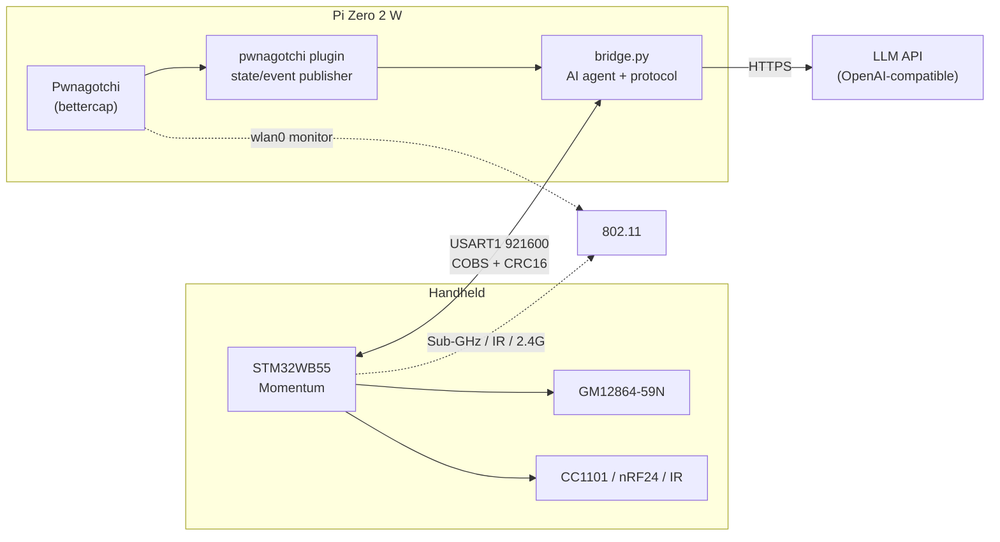

# AI agent and Pwnagotchi bridge

This document defines **how the STM32WB55 talks to a companion computer** so
that AI assistance and Pwnagotchi features do not have to fit in 864 KB of
flash and 192 KB of RAM.

It is deliberately transport-agnostic: the same frames run over USART1
(921600 8N1), USB CDC, or a BLE serial profile.

---

## 1. Goals and non-goals

**Goals**

1. The STM32 boots and works with **no companion attached**.
2. A companion can read device state, drive allow-listed radio/IR actions, and
   stream AI answers to the device.
3. Pwnagotchi runs where it can actually run (Linux), and its state is visible
   on the device.
4. A future ESP32-S3 companion can replace the Pi without changing STM32
   firmware.

**Non-goals**

- Running an LLM on the STM32.
- Streaming raw IQ samples or PCAPs over UART.
- Making the companion the display/input path.
- Remote shell access from the AI.

---

## 2. Options and decision

| | A1 Pi Zero 2 W | A2 ESP32-S3 | B host-tethered |
| --- | --- | --- | --- |
| Real Pwnagotchi (bettercap, monitor mode) | **yes** | no (reimplementation only) | yes (host) |
| AI via HTTPS | yes | yes (mbedTLS) | yes |
| Standalone | yes | yes | no |
| Extra power | 120–400 mA @ 5 V | 80–120 mA @ 3.3 V | 0 |
| Boot time | ~10 s | <1 s | n/a |
| Cost | ~€20 | ~€8 | €0 |
| Flash/RAM pressure on STM32 | none | none | none |

**Decision: A1 is the reference companion; A2 is a supported alternative.**

The STM32 side only sees the protocol, so this is a deployment choice, not an
architecture change.

### 2.1 Topology



### 2.2 Power budget

| Load | Idle | Active | Notes |
| --- | --- | --- | --- |
| STM32WB55 + LCD | ~45 mA | ~70 mA | backlight always on |
| CC1101 | 0.1 mA | 15–30 mA | RX/TX |
| nRF24L01+ | 0.9 mA | 15–115 mA | PA/LNA peaks |
| microSD | 0.2 mA | 50 mA burst | |
| Pi Zero 2 W | 120 mA | 250–400 mA | Wi-Fi + bettercap |
| **Total with Pi** | ~170 mA | ~500 mA | ~4 h on 2000 mAh |
| **Total without Pi** | ~50 mA | ~150 mA | ~13 h on 2000 mAh |

This is why the Pi must be power-gated when unused (MOSFET or its own switch),
and why the AI/Pwnagotchi features are optional.

---

## 3. Link layer

### 3.1 Electrical

| Parameter | Value |
| --- | --- |
| UART | USART1, `PB6` TX / `PB7` RX, 3.3 V |
| Baud | 921600 8N1, no flow control |
| Wiring | cross TX/RX, common GND (see pinout §7.6) |
| Optional | companion asserts a `LINK_READY` GPIO after boot (not required) |

### 3.2 Framing

```
┌────────┬─────────┬────────┬───────┬─────────┬──────────────┬────────┐
│ 0x00   │ COBS-encoded frame ...                              │ 0x00   │
└────────┴─────────────────────────────────────────────────────┴────────┘
```

- **COBS** (Consistent Overhead Byte Stuffing) removes every `0x00` from the
  payload; `0x00` is the only delimiter. Worst-case overhead: 1 byte per 254.
- Decoded frame layout (little-endian):

| Offset | Size | Field | Notes |
| --- | --- | --- | --- |
| 0 | 1 | `version` | `0x01` |
| 1 | 1 | `type` | see §3.3 |
| 2 | 1 | `seq` | wraps at 255; ACKed frames are retried |
| 3 | 1 | `flags` | bit0 = ACK required, bit1 = response, bit2 = more/stream |
| 4 | 2 | `payload_len` | 0..1024 |
| 6 | N | `payload` | UTF-8 JSON (or empty) |
| 6+N | 2 | `crc16` | CRC-16/CCITT-FALSE over bytes 0..6+N-1 |

- Maximum decoded frame: 1032 bytes. Maximum encoded: ~1040.
- **CRC-16/CCITT-FALSE**: poly `0x1021`, init `0xFFFF`, no reflection, xorout
  `0x0000`.
- A frame with a bad CRC is dropped silently (counted in diagnostics).
- **ACK**: the receiver answers a frame with `flags & ACK_REQ` using a
  zero-payload `TYPE_ACK` frame carrying the same `seq`. Timeout 300 ms,
  3 retries, then the link is marked degraded.
- **Heartbeat**: both sides send `TYPE_HEARTBEAT` every 2 s when idle; 6 s of
  silence marks the peer offline.

### 3.3 Message types

| Type | Name | Direction | Payload |
| --- | --- | --- | --- |
| `0x01` | `HELLO` | both | `{"proto":1,"fw":"...","caps":["ai","pwn","subghz"]}` |
| `0x02` | `ACK` | both | empty |
| `0x03` | `HEARTBEAT` | both | `{"uptime":123,"state":"ok"}` |
| `0x10` | `STATUS_REQ` | either | empty |
| `0x11` | `STATUS` | either | `{"battery":87,"voltage":3.92,"temp":31,"radio":"idle"}` |
| `0x20` | `AI_REQ` | STM32→Pi | `{"id":"a1","prompt":"...","context":"...","tools":["status"]}` |
| `0x21` | `AI_RESP` | Pi→STM32 | `{"id":"a1","text":"...","tool_call":null}` |
| `0x22` | `AI_CHUNK` | Pi→STM32 | `{"id":"a1","delta":"..."}` (streaming) |
| `0x30` | `CMD` | Pi→STM32 | `{"id":"c1","op":"subghz_rx","args":{...}}` |
| `0x31` | `CMD_RESULT` | STM32→Pi | `{"id":"c1","ok":true,"result":{...}}` |
| `0x40` | `TELEMETRY` | Pi→STM32 | `{"pwn":{"epoch":12,"aps":34,"hs":7},"wifi":{"ssid":"..."}}` |
| `0x41` | `EVENT` | both | `{"kind":"handshake","data":{...}}` |
| `0x50` | `LOG` | both | `{"level":"warn","msg":"..."}` |
| `0x7F` | `ERROR` | both | `{"code":"bad_cmd","msg":"..."}` |

`AI_REQ` and `CMD` carry a client-generated `id`; the reply must echo it. That
makes retries idempotent: the receiver keeps a 16-entry LRU of recent ids and
returns the cached result instead of executing twice.

### 3.4 Allow-listed command ops

Only these ops are executable from the companion. Everything else returns
`{"code":"bad_cmd"}`. This is the boundary that keeps a prompt-injected model
from turning the device into a remote shell.

| Op | Args | Result | Safety |
| --- | --- | --- | --- |
| `status` | — | battery/voltage/uptime | always allowed |
| `display_text` | `{"line1":"...","line2":"..."}` | ok | allowed |
| `ir_rx` | `{"timeout_ms":5000}` | `{"protocol":"NEC","code":"0x20DF..."}` | allowed |
| `ir_tx` | `{"protocol":"NEC","code":"0x20DF..."}` | ok | **requires `armed:true`** |
| `subghz_rx` | `{"freq":433920000,"timeout_ms":5000}` | `{"rssi":-71,"raw":false}` | allowed (receive only) |
| `subghz_tx` | `{"freq":...,"preset":"Ook650Async","data":"..."}` | ok | **requires `armed:true`** |
| `nrf24_scan` | `{"channels":[0,125],"dwell_ms":20}` | `{"hits":[...]}` | allowed |
| `nrf24_tx` | `{"channel":76,"payload":"..."}` | ok | **requires `armed:true`** |
| `pwn_status` | — | last telemetry snapshot | allowed |

`armed:true` is only accepted when the user has enabled "allow transmissions"
in the device settings **and** the companion sends a per-session token obtained
from `CMD {op:"arm"}` after a physical confirmation (e.g. holding OK). Without
this, a malicious prompt cannot key the transmitter.

### 3.5 Example exchange

```
Pi → STM32   CMD   {"id":"c7","op":"status"}
STM32 → Pi   CMD_RESULT {"id":"c7","ok":true,"result":{"battery":87,"voltage":3.92}}
Pi → STM32   AI_REQ {"id":"a2","prompt":"Is 433.92 MHz busy?","tools":["subghz_rx"]}
STM32 → Pi   CMD   {"id":"c8","op":"subghz_rx","args":{"freq":433920000,"timeout_ms":2000}}
Pi → STM32   CMD_RESULT {"id":"c8","ok":true,"result":{"rssi":-83}}
Pi → STM32   AI_CHUNK {"id":"a2","delta":"433.92 MHz looks "}
Pi → STM32   AI_CHUNK {"id":"a2","delta":"quiet (-83 dBm)."}
```

Note that the AI agent, running on the Pi, calls **back** into the STM32 with a
`CMD` while the `AI_REQ` is still open. The STM32 dispatcher must therefore be
re-entrant: one RX thread, work queued to a worker thread, no blocking inside
the UART callback.

---

## 4. STM32-side implementation plan

1. **Transport abstraction** (`bridge_transport.h`): `send(frame)`, `on_frame`
   callback. Implementations: USART1 via `furi_hal_serial`, USB CDC via
   `furi_hal_usb_cdc`, BLE serial profile.
2. **Codec** (`bridge_codec.c`): COBS + CRC-16, 1 KB static RX ring, one
   1 KB TX buffer, no heap.
3. **Dispatcher**: parse type, validate JSON with a small hand-written parser
   (nanopb is already in the firmware if you prefer Protobuf), enqueue work.
4. **Worker**: executes `CMD` ops by calling the existing Furi APIs
   (`furi_hal_subghz_*`, `furi_hal_infrared_*`, `nrf24_*`), reports results.
5. **UI integration**: a `Bridge` app shows link state, last telemetry, and AI
   text; the status bar can show a link icon.
6. **Watchdog**: if no heartbeat for 6 s, mark offline and cancel pending work.

Memory budget: ~4 KB static buffers + one 2 KB worker stack. No dynamic
allocation, no TLS, no JSON DOM.

---

## 5. Pi-side implementation (`bridge_firmware/pi_bridge/`)

Components:

| File | Role |
| --- | --- |
| `bridge.py` | serial framing, heartbeat, dispatcher, AI agent loop |
| `pwnagotchi_plugin.py` | Pwnagotchi plugin that publishes state/events |
| `wb55-bridge.service` | systemd unit |
| `requirements.txt` | `pyserial`, `requests` |

### 5.1 Pwnagotchi integration

Pwnagotchi's plugin API is the stable surface; scraping its web UI is not. The
plugin (`on_ready`, `on_epoch`, `on_handshake`, `on_wifi_update`) writes:

- `state.json` — epoch, reward, APS, handshakes, uptime, mode;
- `events.fifo` — newline-delimited JSON events (`handshake`, `deauth`,
  `association`, `peer`).

`bridge.py` watches these and forwards `TELEMETRY`/`EVENT` frames. It never
blocks the Pwnagotchi event loop: writes are non-blocking and drop-oldest.

### 5.2 AI agent loop

- OpenAI-compatible chat completions (`/v1/chat/completions`), API key from
  `WB55_LLM_API_KEY`, base URL from `WB55_LLM_BASE_URL`.
- Tools are the allow-listed `CMD` ops. The model never sees raw serial; it
  emits a tool call, `bridge.py` maps it to `CMD`, waits for `CMD_RESULT`, and
  feeds the result back as a tool message.
- System prompt pins the device context (frequencies, limits, safety), and
  refuses transmission tools unless the session is armed.
- Streaming deltas become `AI_CHUNK` frames; the device can render them as they
  arrive.

### 5.3 Failure behaviour

| Condition | Behaviour |
| --- | --- |
| No serial device | retry every 2 s; log once per minute |
| Peer silent 6 s | mark offline, cancel pending AI/CMD, send `LOG` on reconnect |
| CRC errors > 10/min | log, keep link but reduce rate |
| LLM timeout (10 s) | return `AI_RESP` with an error string, no tool execution |
| Tool call not allow-listed | return `ERROR bad_cmd` to the model, never execute |
| Device reboots | `HELLO` handshake re-establishes; pending ids are dropped |

---

## 6. ESP32-S3 variant (`bridge_firmware/esp32s3_bridge/`)

What it can do:

- Wi-Fi scan / RSSI telemetry (`wifi_scan`), HTTP(S) LLM calls, BLE HID.
- The same `HELLO`/`STATUS`/`AI_REQ`/`CMD` frames.

What it cannot do:

- Run Pwnagotchi (no monitor mode, no bettercap). The ESP32 "pwnagotchi"
  projects are independent reimplementations with a different feature set;
  treat them as Wi-Fi recon tools, not Pwnagotchi.
- Hold a large tool-call context; keep prompts short and responses capped.

Use it when the goal is "AI chat + Wi-Fi recon" in a small, low-power build.

---

## 7. Security and privacy

1. **No secrets on the STM32.** API keys, SSIDs and handshakes stay on the
   companion.
2. **TLS verification on** in both companions; never `setInsecure()` in
   production.
3. **Allow-list, not shell.** The AI can only emit the ops in §3.4. There is no
   `exec`, no file write, no arbitrary serial passthrough.
4. **Arming gate for TX.** `armed:true` requires a physical confirmation and a
   session token; default is receive-only.
5. **Prompt injection.** Pwnagotchi SSIDs and captured data are untrusted input;
   they are passed to the model as data, and the system prompt forbids following
   instructions found in them. Tool calls are validated structurally, not by
   trust.
6. **Logging.** `LOG` frames are rate-limited and never include key material or
   full handshakes.
7. **Legal.** Sub-GHz/nRF24 transmission and Wi-Fi attacks are regulated in most
   jurisdictions. The default build is receive-only; the operator is
   responsible for compliance.

---

## 8. Test plan

| Test | Method | Pass |
| --- | --- | --- |
| Framing | send 10k random frames, loopback | 0 CRC escapes, 0 drops |
| ACK/retry | drop every 3rd ACK | all commands eventually complete |
| Idempotency | replay same `CMD id` 5× | one execution |
| Flow control | 1 KB AI chunks at 921600 | no overrun, < 5 ms latency |
| Companion absent | boot device alone | normal UI, no error dialogs |
| Reconnect | yank UART, replug | `HELLO` within 2 s, no reboot needed |
| Malformed JSON | fuzz payloads | `ERROR bad_json`, link stays up |
| Unarmed TX | `ir_tx` without arm | refused |
| Power loss | cut 5 V to Pi during AI_REQ | device stays up, request times out |

---

## 9. Open questions

1. Whether Pwnagotchi's plugin API in the chosen fork exposes epoch reward and
   handshake counts in a stable shape (the plugin already guards with
   `try/except` and degrades to zeros).
2. Whether BLE serial (existing Flipper serial profile) is fast enough for AI
   streaming; UART is the reference.
3. Whether the STM32 should expose a tiny JSON parser or reuse nanopb with a
   `.proto` (nanopb is already linked). Protobuf saves ~30 % bytes but makes
   debugging harder; JSON is the v1 choice.
